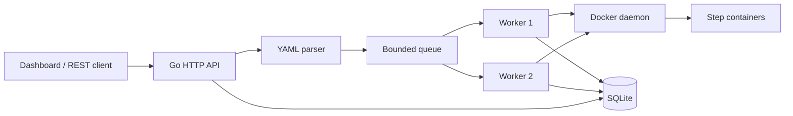
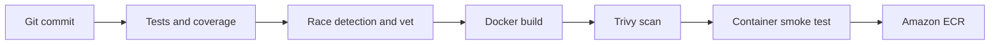

# Forge

A lightweight, container-native CI/CD execution engine written in Go. Forge runs YAML-defined pipelines in Docker containers, schedules concurrent jobs, and provides a web dashboard for inspecting build history and execution logs.

**Current application version:** v0.2.0 · **Status:** experimental, single-host MVP

## Features

- YAML pipeline validation and command-line execution.
- Sequential steps in separate Docker containers; fail-fast execution, timeouts and cleanup.
- Two concurrent workers with a bounded queue of 32 waiting jobs.
- SQLite-backed job history, timestamps, status and execution logs.
- REST API and embedded HTML/CSS/JavaScript dashboard with polling.
- Multi-stage Docker image and automated tests, race detection, coverage and vulnerability gates.
- Commit-tagged container delivery to Amazon ECR.

## Architecture



## Quick start

Requirements: Go 1.26.11 or newer compatible toolchain, Docker CLI and running Docker daemon, Git, and a shell. Commands below target Linux or WSL.

```bash
git clone https://github.com/mittalsukhansh/forge.git
cd forge
go mod download
go build -o forge ./cmd/forge
./forge run examples/pipeline.yml
./forge serve
```

Open http://127.0.0.1:8080 in your browser. The server defaults to loopback and stores history in `forge.db`.

| Variable | Default (native execution) |
| --- | --- |
| FORGE_ADDR | 127.0.0.1:8080 |
| FORGE_DB | forge.db |

## Pipeline format

```yaml
name: Example pipeline
steps:
  - name: Environment check
    image: alpine:3
    commands:
      - uname -a
  - name: Test
    image: alpine:3
    commands:
      - test "$((2 + 2))" -eq 4
      - echo "Tests passed"
```

Save as a YAML file and run `./forge run path/to/pipeline.yml`. Each step uses a fresh container with networking disabled. Steps do not share a filesystem. The current engine does not clone repositories or persist build artifacts.

## REST API

| Method | Route | Description |
| --- | --- | --- |
| GET | / | Dashboard |
| GET | /health | Application health and version |
| POST | /api/jobs | Queue a pipeline (JSON with a pipeline YAML string) |
| GET | /api/jobs | Latest 100 jobs |
| GET | /api/jobs/{id} | Job details and execution logs |

```bash
python3 -c 'import json; print(json.dumps({"pipeline":open("examples/pipeline.yml").read()}))' |
  curl -fsS -X POST http://127.0.0.1:8080/api/jobs \
    -H 'Content-Type: application/json' --data-binary @-
curl -fsS http://127.0.0.1:8080/api/jobs
```

## Run with Docker

On a trusted Linux Docker host:

```bash
docker build -t forge:local .
docker volume create forge-data
docker run --rm --name forge-server \
  --group-add "$(stat -c '%g' /var/run/docker.sock)" \
  -p 127.0.0.1:8080:8080 \
  -v forge-data:/data \
  -v /var/run/docker.sock:/var/run/docker.sock \
  forge:local
```

**Security warning:** Docker socket access is highly privileged and may effectively grant host-level control. Forge has no authentication and is intended only for trusted local pipelines. Never expose its execution API to the public internet. Container isolation is not a sufficient sandbox for arbitrary untrusted code.

## Testing

```bash
go test ./...
docker pull alpine:3
FORGE_DOCKER_TESTS=1 go test -count=1 -coverpkg=./... -coverprofile=coverage.out ./...
go tool cover -func=coverage.out
FORGE_DOCKER_TESTS=1 CGO_ENABLED=1 go test -race ./...
go vet ./...
```

The race detector requires a compatible C compiler. The quality script enforces a 60% coverage threshold.

### Demonstrated results

| Metric | Observed result |
| --- | --- |
| Statement coverage | 65.4% |
| Docker step execution coverage | 95.7% |
| Race detection and static analysis | Passed |
| Local runtime image | 52.1 MB |
| Compressed ECR image | Approximately 18.76 MiB |
| Trivy HIGH/CRITICAL findings | None detected in the demonstrated initial scan |
| Published v0.2.0 smoke execution | Three steps succeeded in 1.069 seconds |

These are observed development results, not guarantees or production benchmarks.

## Container delivery



The repository includes an AWS CodeBuild-format `buildspec.yml`. Native CodeBuild was restricted in the AWS Academy Learner Lab, so the demonstrated workflow used a Python buildspec runner and a session-dependent Git polling watcher in CloudShell.

- `scripts/quality.sh`: tests, coverage gate, static analysis and race detection.
- `scripts/security.sh`: vulnerability report and fixable critical vulnerability gate.
- `scripts/smoke.sh`: starts the image and executes a real pipeline.
- `scripts/runner.py`: executes buildspec commands.
- `scripts/watch.sh`: polls GitHub for new commits and tracks successful releases.

To reproduce the AWS workflow, configure your own AWS account and region in the buildspec, create a private ECR repository named forge, and authenticate the AWS CLI with appropriately authorized credentials. Install Python and PyYAML in a virtual environment, then run `python scripts/runner.py`. Do not commit credentials. Run only one release process at a time and avoid editing the watcher's checkout during builds.

## Repository layout

```text
cmd/forge/          CLI and HTTP server entry point
internal/api/       REST API and embedded dashboard
internal/pipeline/  YAML parser and validation
internal/engine/    Docker execution
internal/queue/     Concurrent worker pool
internal/store/     SQLite persistence
examples/           Demonstration pipelines
scripts/            Quality, security and release automation
Dockerfile          Multi-stage runtime image
buildspec.yml       Container delivery configuration
```

## Limitations and roadmap

The current queue is in memory; interrupted jobs are marked failed on restart. Logs are capped, dashboard metrics cover the most recent 100 jobs, and HTTP health does not establish Docker daemon readiness. The watcher requires an active session. Future work includes repository checkout, shared workspaces, artifact management, authenticated access, stronger execution isolation, webhook triggers and distributed workers. ECS/Fargate deployment is not implemented.

Forge was developed as an AWS CI/CD assignment and is being extended as a backend and infrastructure engineering portfolio project.
